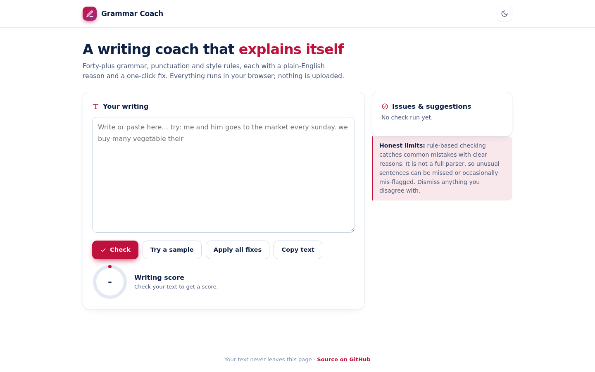
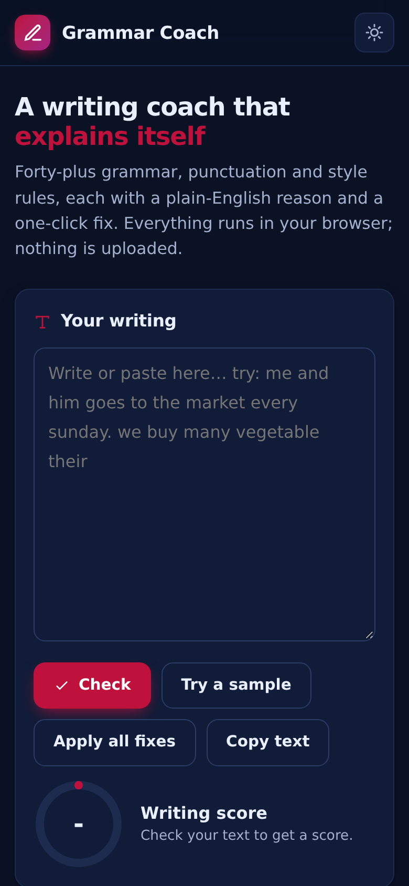

# Grammar Coach

On-device grammar, punctuation and style checking with 40+ explainable rules. Every suggestion comes with a plain-English reason and a one-click fix.

**Live demo: https://akash991833.github.io/grammar-corrector/**



## Features

- **40+ rules**: repeated words, a/an, subject-verb agreement ("he don't" -> "he doesn't"), could/should/would of, me-and-X subjects, much/many, less/fewer, then/than, double comparatives, its/it's, capitalization (sentences, days, months, "I"), spacing and punctuation, wordy phrases ("due to the fact that" -> "because"), and more.
- **Explainable** - each issue names the rule in plain English.
- **Apply one fix or apply all** (safe two-pass application, no overlaps).
- **Writing score** ring that updates with every check.
- **Dark and light mode**, mobile friendly, installable PWA.



## Honest limits

This is a rule engine, not a full parser. It catches common mistakes reliably but can miss or occasionally mis-flag unusual sentences. Dismiss anything you disagree with.

## Tech

Vanilla HTML/CSS/JS, zero network calls. Your text never leaves the page.

## Run locally

```bash
python3 -m http.server 8000
```

---

## 🐍 Python version (real ML backend) - `python-app/`

The browser demo above is fully client-side. This folder is the **pro-grade version** with a real training pipeline on real data:

Neural grammar correction with a T5 model fine-tuned for grammatical error correction - catches subject-verb agreement, articles, tense and more, with a change-by-change explanation. Stack: Python, Gradio, Transformers (CPU).

```bash
cd python-app
pip install -r requirements.txt
python app.py
```

Deploy free on **Hugging Face Spaces** (no card): create a Space, upload the `python-app/` folder - it ships Space-ready (`sdk` + `app_file` already set in its README).
